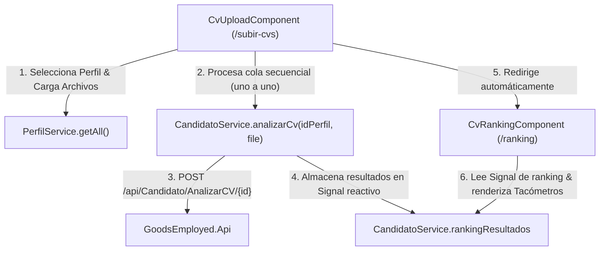

# Plan Técnico de Implementación: Análisis de CVs y Ranking con Tacómetro

- **Identificador:** 002-cv-analisis-ranking
- **Estado:** aprobado
- **Basado en:** `docs/specs/002-cv-analisis-ranking/spec.md`
- **Metodología:** SDD (Spec-Driven Development)

---

## 1. Arquitectura y Módulos

---

## 2. Archivos y Modificaciones

### A. Nuevos Archivos
1. `src/app/models/candidato.model.ts`:
   * Interfaces: `EvaluacionDetalladaItem`, `AnalisisCvResponse`, `CandidatoResultadoItem`.
2. `src/app/services/candidato.service.ts`:
   * Servicio injectable Angular.
   * Método `analizarCv(idPerfil: number, archivo: File): Observable<ApiResponse<AnalisisCvResponse>>`.
   * Signal de estado `readonly rankingResultados = signal<CandidatoResultadoItem[]>([])`.
   * Signal de perfil analizado `readonly perfilAnalizadoNombre = signal<string>('')`.
3. `src/app/components/cv-ranking/cv-ranking.component.ts`:
   * Componente standalone con Signals para items expandidos y navegación.
4. `src/app/components/cv-ranking/cv-ranking.component.html`:
   * Podio de candidatos ordenados por porcentaje, SVG gauge semicircular tipo tacómetro interactivo, cards de error y acordeón de skills.
5. `src/app/components/cv-ranking/cv-ranking.component.css`:
   * Estilos minimalistas Apple, CSS ultra-compacto (<3.5 kB).

### B. Archivos Modificados
1. `src/app/components/cv-upload/cv-upload.component.ts`:
   * Inyecta `PerfilService`, `CandidatoService`, `Router`.
   * Carga de perfiles disponibles en `ngOnInit`.
   * Signal `selectedPerfilId = signal<number | null>(null)`.
   * Método secuencial `analizarCvsSecuencial()`.
   * Signals `isAnalizando`, `progresoActual`, `progresoTotal`.
2. `src/app/components/cv-upload/cv-upload.component.html`:
   * Selector dropdown de perfil.
   * Barra de estado de progreso secuencial.
   * Botón principal "Analizar CVs".
3. `src/app/components/cv-upload/cv-upload.component.css`:
   * Estilos de selector y barra de progreso.
4. `src/app/app.routes.ts`:
   * Incorporación de `{ path: 'ranking', component: CvRankingComponent }`.

---

## 3. Decisiones Técnicas y Alternativas Descartadas

- **Tacómetro mediante SVG puro vs Canvas/Librería:** Se optó por un SVG nativo con `stroke-dasharray` / `stroke-dashoffset` en arco semicircular (180 grados).
  * *Alternativa descartada:* Librerías como Chart.js o Gauge.js. Se descartaron para cumplir estrictamente con `AGENTS.md` (no añadir dependencias externas) y preservar el peso del bundle.
- **Cola secuencial cliente vs llamada simultánea:** Se procesan mediante `for...of` con promesas asíncronas consecutivas.
  * *Razón:* Respeta el requisito explícito del usuario de enviar "de uno en uno" y esperar la respuesta de cada uno antes de continuar con el siguiente.
- **Transferencia de Estado:** Se usa `CandidatoService` con Signals reactivos.
  * *Razón:* Protege la privacidad de los candidatos y evita pasar datos pesados o blobs en URLs o query params.
