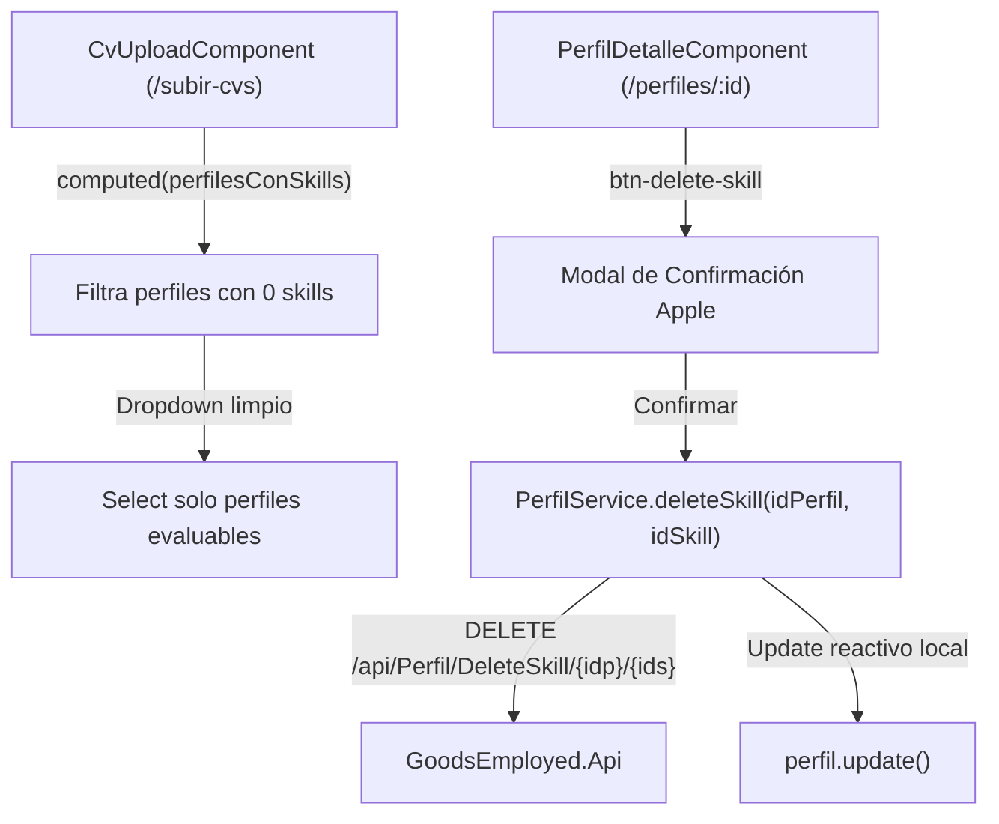

# Plan Técnico: Filtrado de Perfiles en Cascada y Borrado de Skills

- **Identificador:** 003-dropdown-filtro-delete-skill
- **Estado:** aprobado
- **Basado en:** `docs/specs/003-dropdown-filtro-delete-skill/spec.md`
- **Metodología:** SDD (Spec-Driven Development)

---

## 1. Arquitectura y Componentes Afectados

---

## 2. Archivos y Modificaciones

1. `src/app/services/perfil.service.ts`:
   * Método `deleteSkill(idPerfil: number, idSkill: number): Observable<ApiResponse<any>>`.
2. `src/app/components/cv-upload/cv-upload.component.ts` y `.html`:
   * `perfilesConSkills = computed(...)`.
   * Template `@for` iterando sobre `perfilesConSkills()`.
   * Mensaje de aviso y enlace si no hay perfiles aptos.
3. `src/app/components/perfil-detalle/perfil-detalle.component.ts`, `.html` y `.css`:
   * Botón SVG de papelera en cada card con `stopPropagation()`.
   * Alerta modal destructiva estilo Apple.
   * Manejo reactivo de estado de perfil vacío al eliminar la última skill.
   * CSS compacto (<4kB warning, <8kB budget).
